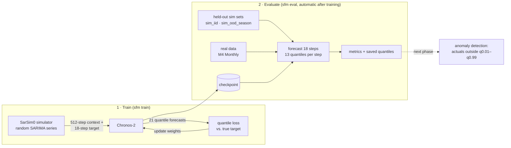

# SarSim0 forecasting models — D05 Anomaly team

Train time-series forecasting models on [SarSim0](https://github.com/kashif/sarsim0) synthetic data
("Zero-shot Forecasting by Simulation Alone", arXiv 2601.00970) and evaluate them zero-shot on
held-out simulated data and M4 Monthly. The saved quantile forecasts are the starting point for
forecast-residual anomaly detection.

Everything runs through one CLI, `sfm`, driven by YAML configs. The same config runs on a laptop
CPU, a consumer GPU, or DSMLP; only `--device` changes. Terms in *italics* are defined in the
[Glossary](#glossary).

## How it works

### The idea

We want a forecaster that works on data it has never been trained on, such as household
electricity, without collecting and labelling that data first. The SarSim0 paper's bet is that a
model trained **only on simulated series** can do this, as long as the simulator produces enough
*variety* (trends, seasonal cycles of many lengths, noise of many shapes) for the model to learn
general forecasting skills, not the quirks of one dataset. SarSim0 series are not meant to look
like any particular real data. They are meant to be diverse.

Once we have a forecaster that is good zero-shot, anomaly detection follows from its *quantile
forecasts*: the model gives a range of likely next values, and an actual reading far outside that
range (below q0.01 or above q0.99) gets flagged.

### The pipeline



1. **Environment** (`uv sync`, `sfm check`): install the pinned packages for CPU or GPU, then
   confirm SarSim0 and a few training steps work on this machine and how fast they run.
2. **Eval sets** (`sfm make-sim`, `sfm stage-m4`): write fixed test data to `data/eval/`. The
   model never trains on these. Two are simulated (one like training, one with seasonal periods
   training never produces) and one is real (M4 Monthly).
3. **Baselines** (`sfm eval --model seasonal_naive --model chronos2:amazon/chronos-2`): the bar
   to beat. Seasonal naive is the "dumb" forecast; pretrained Chronos-2 is Amazon's model before
   we touch it.
4. **Train** (`sfm train <config>`): stream SarSim0 data into Chronos-2 and update its weights
   (details below). The config decides fine-tune vs. from scratch, steps, batch size,
   learning rate and device.
5. **Evaluate**: the final checkpoint forecasts every eval set. Per-series scores and the full
   quantile forecasts go to `outputs/<run>/eval/`.
6. **Compare** (`sfm results`): one markdown table of every run vs. the baselines, ready for the
   Experiments log.

### One training step, concretely

1. SarSim0 simulates `data.batch_size` series of 6,200 points and drops the first 200 (*burn-in*).
2. A random 530-point window is cut from each: the first 512 points are the *context*, the
   next 18 are the *target*.
3. Chronos-2 reads the context and predicts 21 *quantiles* (0.01 … 0.99) for each of the 18
   future steps.
4. The *quantile loss* scores those predictions against the true 18 values.
5. Backpropagation computes gradients and AdamW updates the weights. With `grad_accum: k`, the
   gradients of k batches are added up before a single update.

Nothing is stored: each step sees brand-new simulated series, so there are no epochs and no fixed
training set to overfit. This is why a separate held-out set is needed to measure progress.

## Layout

```text
configs/
  data/sim-heldout.yaml          held-out SarSim0 eval sets (seeds, sizes, unseen seasonalities)
  train/_base-chronos2.yaml      shared defaults; other train configs `inherit:` it
  train/chronos2-ft-smoke.yaml   original 100-step plumbing check
  train/chronos2-ft-cpu.yaml     fine-tune on a laptop CPU (~25 min)
  train/chronos2-ft-gpu.yaml     fine-tune on one GPU (~2 h on a 3070 Ti)
  train/chronos2-scratch-gpu.yaml  random init, SarSim0 only ("simulation alone")
  sweeps/chronos2-ft-lr.yaml     example W&B sweep (learning rate x seasonal range)
src/sarsim_fm/
  cli.py          `sfm` commands
  config.py       YAML loading, `inherit:`, `--set key=value` overrides
  runtime.py      device/precision selection, environment + git info for run records
  tracking.py     optional Weights & Biases logging (no-op unless enabled)
  metrics.py      sMAPE, MASE, scaled quantile loss, coverage
  evaluate.py     score any model on any eval set, save per-series quantiles
  data/           eval-set format, M4 staging, SarSim0 stream + held-out generation
  models/         registry + one file per model family (chronos2, seasonal naive)
tests/            fast unit tests (`uv run pytest`)
data/  outputs/  external/        generated locally, git-ignored
```

Use notebooks (`notebooks/`, install with `--extra notebooks`) for looking at results: they read
`outputs/**/eval/*.parquet`. Keep training and evaluation in the CLI so every number has a config
and a `run-config.json` behind it.

### What each module does

| Module | Role | Main functions |
|---|---|---|
| `cli.py` | The `sfm` command. Each subcommand reads its config, picks the device, and calls the modules below. | `cmd_check`, `cmd_make_sim`, `cmd_stage_m4`, `cmd_train`, `cmd_eval`, `cmd_results` |
| `config.py` | Reads a YAML config, merges the file named in `inherit:` underneath it, and applies `--set` overrides. | `load_config`, `set_dotted` |
| `runtime.py` | Decides where and how to compute: device (`auto` → CUDA if present, else CPU) and precision (bf16 on capable GPUs). Collects versions, GPU name and git SHA for `run-config.json`. | `resolve_runtime`, `environment_info` |
| `data/sim.py` | Everything SarSim0. Turns the YAML `sarsim:` block into a `SarSimConfig` (defaults: univariate, no covariates, length 6,000), builds the endless training stream, and writes the fixed held-out sets. | `sarsim_config`, `training_stream`, `make_heldout_split` |
| `data/m4.py` | Converts the M4 Monthly CSVs into the eval-set format and checks counts and horizons. | `stage_m4_monthly` |
| `data/eval_sets.py` | The single on-disk format all eval sets share, with validation on write. | `write_eval_set`, `load_eval_set`, `EvalSet` |
| `models/__init__.py` | The registry: maps a spec like `chronos2:outputs/run/checkpoint-final` to the code that loads or trains it. | `load_forecaster`, `get_trainer`, `Forecaster` |
| `models/chronos2.py` | Chronos-2 specifics: load a checkpoint for forecasting, build a model (pretrained or random weights), train it with the Hugging Face Trainer, and time raw training steps for `sfm check`. | `load`, `build_model`, `train`, `timed_steps` |
| `models/naive.py` | Seasonal naive baseline. | `SeasonalNaive` |
| `evaluate.py` | Runs any forecaster on any eval set, scores each series, and saves quantiles plus a summary. | `evaluate`, `save_eval` |
| `metrics.py` | The metric formulas. | `smape`, `mase`, `naive_scale`, `scaled_quantile_loss`, `quantile_loss`, `coverage` |
| `tracking.py` | Optional W&B logging: opens a run with the resolved config, writes eval metrics and timing to its summary. Does nothing unless `wandb.enabled` (or under `wandb agent`). | `start_run`, `log_eval`, `finish` |

What `sfm train configs/train/chronos2-ft-cpu.yaml` calls, in order:

```text
config.load_config            read YAML + inherit + --set
runtime.resolve_runtime       pick cpu/cuda, bf16 or fp32
→ write outputs/<name>/run-config.json
models.get_trainer("chronos2") → chronos2.train
    chronos2.build_model          pretrained weights or random init
    data.sim.training_stream      endless SarSim0 batches
    Chronos2Trainer.train()       the training loop (Hugging Face)
    → checkpoint-final/, train-log.csv
models.load_forecaster("chronos2:<checkpoint-final>")
for each eval set in eval.datasets:
    data.eval_sets.load_eval_set → evaluate.evaluate → evaluate.save_eval
```

## Setup

Requires [uv](https://docs.astral.sh/uv/) (`curl -LsSf https://astral.sh/uv/install.sh | sh`, or
`pip install --user uv` on DSMLP). `uv.lock` pins every package, including SarSim0 at commit
`71306403`, so all machines get identical versions.

```bash
git clone git@github.com:DSC-Capstone-Azimuth-AI/chronos2-sarsim0-anomaly-team.git
cd chronos2-sarsim0-anomaly-team

uv sync --extra cpu      # laptop / no NVIDIA GPU (macOS uses the default PyPI torch)
uv sync --extra cu130    # NVIDIA GPU (driver supporting CUDA 13: local or DSMLP)

export HF_HOME="$PWD/.cache/huggingface"   # optional: keep model downloads in the repo
uv run sfm check                           # environment report, SarSim0 checks, timed train steps
```

`uv run sfm ...` uses the project environment without activating it; `source .venv/bin/activate`
then `sfm ...` also works.

## Running it

```bash
# 1. Eval sets (once per machine)
uv run sfm make-sim                        # data/eval/sim_iid + sim_ood_season (~10 s)

git clone --depth 1 --filter=blob:none --sparse \
  https://github.com/Mcompetitions/M4-methods.git external/M4-data
git -C external/M4-data sparse-checkout set Dataset
uv run sfm stage-m4                        # data/eval/m4_monthly

# 2. Baselines
uv run sfm eval --model seasonal_naive --model chronos2:amazon/chronos-2

# 3. Train; the final checkpoint is evaluated on every set listed in `eval.datasets`
uv run sfm train configs/train/chronos2-ft-cpu.yaml
# Modify settings on the fly
uv run sfm train configs/train/chronos2-ft-gpu.yaml --set train.max_steps=500 --set name=ft-500

# 4. Every result so far, as a markdown table (paste into the Experiments log)
uv run sfm results
```

Useful flags:

| Flag | Effect |
|---|---|
| `--device auto\|cpu\|cuda\|cuda:1\|mps` | override `runtime.device` (`auto` = CUDA if available, else CPU) |
| `--precision auto\|bf16\|fp32` | `auto` = bf16 on GPUs that support it, fp32 otherwise |
| `--set a.b=value` | override any config field; values are parsed as YAML (`--set eval.datasets=[sim_iid]`) |
| `--overwrite` | replace an existing run directory with the same `name` |
| `sfm check --config X --set data.batch_size=128` | measure s/step and peak VRAM before a long run |

Each run writes `outputs/<name>/`:

```text
run-config.json      resolved config + device, package versions, git SHA, dirty flag, SarSim0 commit,
                     and `timing` (train/eval/total seconds, finish time) once the run ends
train-log.csv        loss, grad norm, learning rate per logging step
checkpoint-final/    loadable with Chronos2Pipeline.from_pretrained / `--model chronos2:<path>`
eval/<set>.parquet   per-series metrics + 13 quantiles (0.01 … 0.99) for every horizon step
eval/summary.json    aggregate metrics per eval set
```

## Experiment tracking (Weights & Biases)

Optional. Local files under `outputs/` stay the source of truth; W&B adds a shared, filterable
table of every run across machines, plus live loss curves.

```bash
uv sync --extra cu130 --extra wandb      # or --extra cpu
uv run wandb login                       # once per machine (API key from wandb.ai/authorize)
```

Turn it on per run (or set `wandb.enabled: true` in a config):

```bash
uv run sfm train configs/train/chronos2-ft-gpu.yaml \
  --set wandb.enabled=true --set wandb.group=lr-search
uv run sfm eval --model seasonal_naive --model chronos2:amazon/chronos-2 --wandb   # baseline rows
```

How runs are organized, all in one project (`sarsim-fm` under `chewycrunch-ucsd`):

| W&B field | Holds | Use it to |
|---|---|---|
| `config` | the full resolved YAML (after `inherit:` and `--set`) | filter/group by `model.type`, `data.sarsim.*`, `train.*` |
| `group` | `wandb.group`: the question the run answers | e.g. `sarsim-season-ablation`, `lr-search` |
| `job_type` | `train` or `baseline` | hide baselines or keep them as reference rows |
| `tags` | `model.type`, `model.init`, device + `wandb.tags` | quick filters |
| summary | `eval/<set>/<metric>` (sMAPE, MASE, SQL, WQL, coverage), `timing/*` | sort the runs table |

The Hugging Face Trainer logs loss, learning rate and grad norm to the same run while training.

**Sweeps** (cheap searches only; long runs stay as files in `configs/train/`):

```bash
uv run wandb sweep configs/sweeps/chronos2-ft-lr.yaml    # prints the sweep id
uv run wandb agent chewycrunch-ucsd/sarsim-fm/<id>       # on each machine that should take runs
```

The agent runs `sfm train <config> key.path=value ...`; bare `key=value` arguments after the
config path work like `--set`. Each sweep run's directory gets the W&B run id appended. Sweep on
the simulated held-out sets, not M4: M4 is the zero-shot real-data test and should not steer
model selection.

`WANDB_MODE=offline` logs locally (`wandb sync` later); `WANDB_PROJECT` / `WANDB_ENTITY` override
the defaults in `src/sarsim_fm/tracking.py`.

## Eval sets

All eval sets share one parquet format (`item_id`, `context`, `target`, `season_length`; see
`src/sarsim_fm/data/eval_sets.py`), so every model and metric works on every set. New datasets
(DERCONNECT, PLAID) only need a writer for this format.

| Set | Series | Horizon | Season | What it tests |
|---|---:|---:|---:|---|
| `sim_iid` | 2,000 | 18 | 1 | Same SarSim0 distribution as training, seed 1000003 |
| `sim_ood_season` | 2,000 | 18 | 1 | SarSim0 with periods 60–120; training only produces ≤ 52 |
| `m4_monthly` | 48,000 | 18 | 12 | Official M4 train/test split |

Held-out series are generated one per call: SarSim0 draws one set of SARIMA parameters per
vectorized call, so generating them in bulk would yield only a few distinct processes.
Their seeds are far from training seeds (training worker *i* uses `data.seed + i`).

## Metrics

| Metric | Definition | Notes |
|---|---|---|
| sMAPE % | mean over series of symmetric MAPE, ×100 | M4 convention. Inflated on sim sets, where many series sit near zero |
| MASE | MAE of median / in-sample seasonal-naive MAE | Main point metric |
| SQL | 2 × mean pinball loss (q = 0.1…0.9) / same naive scale, averaged per series | Probabilistic MASE; equals MASE for a point forecast. Main metric for sim sets |
| WQL | Σ pinball / Σ \|y\| over the whole set | Chronos/GiftEval convention; dominated by large-magnitude series on sim sets |
| Cov 80 / Cov 98 | share of actuals inside [q0.1, q0.9] / [q0.01, q0.99] | Calibration; Cov 98 is the false-alarm side of a residual anomaly detector |

## Results

From `sfm results` (RTX 3070 Ti for evaluation, context length 512):

| Model | Series seen | Train time | sim_iid MASE | sim_iid SQL | sim_ood_season MASE | sim_ood_season SQL | M4 sMAPE % | M4 MASE | M4 Cov 98 |
|---|---:|---:|---:|---:|---:|---:|---:|---:|---:|
| Seasonal naive | — | — | 1.1901 | 1.1901 | 1.1375 | 1.1375 | 15.99 | 1.2597 | 0.014 |
| `amazon/chronos-2` (pretrained, zero-shot) | — | — | 0.6343 | 0.5255 | 0.6234 | 0.5102 | 13.11 | 0.9221 | 0.973 |
| `chronos2-ft-cpu` (fine-tune, 1k steps × batch 8, lr 1e-5, CPU) | 8k | 24.7 min (CPU) | 0.6289 | 0.5216 | 0.6158 | 0.5045 | 13.08 | 0.9174 | 0.960 |
| `ft-500` (fine-tune, `chronos2-ft-gpu` cut to 500 steps × 256, lr 1e-5) | 128k | 11.0 min (3070 Ti) | 0.6248 | 0.5176 | 0.6105 | 0.4987 | **12.75** | **0.9038** | 0.973 |
| `chronos2-ft-gpu-3070ti` (fine-tune, full `chronos2-ft-gpu`: 5k steps × 256, lr 1e-5) | 1.28M | 1.83 h (3070 Ti) | **0.6176** | **0.5114** | **0.6054** | **0.4937** | 12.89 | 0.9242 | 0.965 |
| `chronos2-scratch-gpu` (random init, SarSim0 only: 20k steps × 64 × grad_accum 4, lr 1e-4 cosine) | 5.12M | 7.21 h (3070 Ti) | 0.7024 | 0.5795 | 0.8300 | 0.6726 | 16.63 | 1.3712 | 0.867 |

Commands:
`sfm train configs/train/chronos2-ft-gpu.yaml --set train.max_steps=500 --set name=ft-500`,
`sfm train configs/train/chronos2-ft-gpu.yaml --set name=chronos2-ft-gpu-3070ti` and
`sfm train configs/train/chronos2-scratch-gpu.yaml`.

- The pretrained Chronos-2 M4 numbers reproduce the original pipeline exactly (sMAPE 0.1311438,
  MASE 0.9220801).
- **`ft-500` is the best model on real data (M4).** Training only on SarSim0 lowered M4 MASE by
  2.0%. Paired per-series bootstrap vs. pretrained Chronos-2: ΔMASE −0.018 on M4
  (95% CI [−0.020, −0.017]), −0.010 on sim_iid ([−0.017, −0.003]), −0.013 on sim_ood_season
  ([−0.019, −0.008]); 56–59% of series improved on each set. Interval calibration held: M4 98%
  coverage stayed at 0.973 and 80% coverage moved toward nominal (0.758 → 0.772).
- **Training 10× longer improved simulated data but erased the M4 gain.** `chronos2-ft-gpu-3070ti`
  is the best model on both sim sets (ΔMASE vs. pretrained −0.017 iid, −0.018 OOD; also better
  than `ft-500`), but on M4 it is no better than the untouched pretrained model (ΔMASE +0.002,
  CI [−0.000, +0.004]) and clearly worse than `ft-500` (+0.020, CI [+0.019, +0.022]). Its M4
  98% coverage also dropped to 0.965. M4 sMAPE (12.89) is still below pretrained, so the loss
  is concentrated in series where MASE penalizes larger errors. Training loss was flat after
  ~500 steps (2.82 → 2.80 averaged over 500-step windows), so the extra 4,500 steps mostly moved
  the model toward SarSim0-specific patterns rather than more general skill. This is a
  sim-to-real gap or forgetting effect: more simulated training stops helping real data.
- **The from-scratch ("simulation alone") run beats seasonal naive but not pretrained Chronos-2,
  and does not yet transfer to M4.** On the sim sets it is clearly better than seasonal naive
  (MASE 0.70 vs. 1.19 iid) but behind every pretrained-init model (0.62–0.63). It generalizes
  worse to unseen seasonal periods (sim_ood_season MASE 0.83 vs. 0.70 iid), where fine-tuned
  models barely change between the two sets. On M4 it is worse than seasonal naive (MASE 1.37
  vs. 1.26, sMAPE 16.63 vs. 15.99), and its intervals are too narrow (M4 98% coverage 0.867).
  Training loss was still falling at the end (4.10 → 3.11 averaged over 2,000-step windows,
  vs. ~2.80 for the fine-tunes), so this run is undertrained rather than a negative result: it
  saw 5.12M series, while the paper trains 250k–500k steps at batch 1,024–4,096 (App. E).
- Caveats: one training seed per run (the CIs cover eval-set sampling, not run-to-run noise).
  `ft-500` used the 200-step warmup sized for 5,000 steps, so 40% of its run was warmup. Only
  the last checkpoint was kept (`save_total_limit: 1`), so we cannot see where between step 500
  and 5,000 M4 performance peaked.
- Next: keep every checkpoint (or evaluate during training) to find where real-data performance
  peaks. Choose that step with a **real-data validation set that is not M4** (e.g. M4 Quarterly
  or a GiftEval dataset); picking checkpoints by M4 Monthly score would make M4 no longer a
  zero-shot test. Also worth trying: a lower fine-tuning learning rate, and a much longer
  from-scratch run (or a larger effective batch), since its loss had not plateaued.
- The CPU fine-tune is a small run (training loss 2.93 → 2.90). Read it as "the pipeline trains
  and does no harm" rather than an improvement. It narrowed M4 intervals (98% coverage
  0.973 → 0.960), which `ft-500` did not.

## Adding a model

1. Write `src/sarsim_fm/models/<name>.py` with `load(path, runtime, context_length)` returning an
   object with `predict_quantiles(contexts, horizon, levels, batch_size, season_lengths)` →
   array `(n_series, horizon, n_levels)`. Add `train(cfg, runtime, run_dir)` if it is trainable.
2. Register both in `src/sarsim_fm/models/__init__.py`.
3. Add `configs/train/<name>-*.yaml` with `model.type: <name>`.

Next planned: Chronos-Small (T5), the paper's model. Chronos v1 mean-scales and bins values
into tokens and trains with cross-entropy, so it needs an adapter from SarSim0 windows to
Chronos v1 inputs rather than the Chronos-2 batch stream.

## Known issues and caveats

- **Exploding SarSim0 series.** About 3% of simulated series grow to SarSim0's ±1e6 clip (some
  alternate sign each step) and ~0.25% have all-zero contexts. Training sees the same mix.
  Candidate fix: reject or regenerate such series in the generator.
- **Little diversity per training batch.** Each `data.batch_size` batch shares at most two SARIMA
  parameter sets (see the held-out note above). Prefer gradient accumulation over very large
  micro-batches; more `num_workers` also helps.
- **Fine-tuning is not "simulation alone".** `init: pretrained` starts from `amazon/chronos-2`,
  which was pretrained on real data. `init: scratch` matches the paper's setup.
- **M4 may not be strictly zero-shot for pretrained Chronos models.** Check whether M4 is in
  Chronos-2's pretraining corpus before calling those M4 numbers zero-shot.
- `sfm check` times a raw training loop; inside the HF Trainer, steps take about 2× longer.

## Glossary

**Time-series basics**

| Term | Meaning |
|---|---|
| Time series | Values recorded at regular intervals, e.g. hourly kWh for one home. |
| Context (history) | The past values the model gets to see. 512 steps here; M4 uses each series' full training history, cut to the last 512. |
| Horizon / prediction length / target | How many future steps to forecast (18 here, M4 Monthly's official horizon), and the true values for those steps. |
| Seasonality, period *s* | A pattern that repeats every *s* steps: 24 (time of day, hourly data), 7 (day of week, daily data), 12 (month of year). |
| Trend, integration | Slow drift in level. An *integrated* series is a running sum of another series, so it wanders like a random walk. |
| Point vs. probabilistic forecast | One number per future step vs. a whole distribution of likely values. |
| Quantile *q* | A value the actual should fall below with probability *q*. q0.5 is the median; [q0.1, q0.9] is an 80% interval. |

**SarSim0**

| Term | Meaning |
|---|---|
| SARIMA | Seasonal AutoRegressive Integrated Moving Average, a classic statistical model. Each value is a weighted sum of recent values (AR, order *p*) and recent random shocks (MA, order *q*), plus the same at seasonal lags *s, 2s, …* (orders *P, Q*), then integrated (*d*, *D*). |
| SarSim0 | A simulator that draws **new random SARIMA settings for every series**, so it can produce endless, varied training data. Each series is built as y = N(I(S(ε))): |
| · S, base signal | SARIMA with random orders, coefficients constrained so the series stays stable, period *s* drawn from 0–52 (0 = no seasonality), fractional integration *d* ∈ [0, 1]. |
| · I, SARIMA-2 | For half the series, a second seasonal series (the "envelope") is added to or multiplied with the base, e.g. a daily cycle whose strength changes over the week. Period pairs come from paper Table 9: (24,7), (7,52), (0,7), (0,4), (0,24), (0,52). |
| · N, noiser | Heavy-tailed observation noise: Poisson (count-like), Gamma or Lognormal. |
| Burn-in | The first 200 simulated points are discarded so start-up effects don't appear in the data. |
| Seed | The number that fixes the random generator: the same seed gives the same series. Training and held-out sets use far-apart seeds. |

**Models**

| Term | Meaning |
|---|---|
| Foundation forecaster | A large model trained on many series and then used on new series without retraining. |
| Chronos-2 (`amazon/chronos-2`) | Amazon's ~120M-parameter transformer forecaster. It scales each series, reads the context in 16-step patches, and directly outputs 21 quantiles (0.01 … 0.99) for each future step. Amazon pretrained it on real and synthetic data. |
| Chronos v1 / Chronos-Small (T5) | The earlier Chronos family and the model the SarSim0 paper trains. It turns values into tokens (scale, then bin into a fixed vocabulary), predicts the next token like a language model, and samples to get forecast distributions. Not in this repo yet. |
| Seasonal naive | Baseline that repeats the last season (last 12 months for M4; the last value for sim sets, where season = 1). A model that can't beat it isn't useful. |
| Checkpoint | Saved model weights, loadable for forecasting or further training. |

**Training**

| Term | Meaning |
|---|---|
| Fine-tune (`init: pretrained`) | Start from Amazon's trained weights and keep training on SarSim0. |
| From scratch (`init: scratch`) | Same architecture, random weights, trained only on SarSim0: the paper's "simulation alone" setup. |
| Step | One weight update (optimizer step). |
| Batch size | Series per forward pass (`data.batch_size`). |
| Gradient accumulation | Add up gradients from `grad_accum` batches before one update. Effective batch = `batch_size × grad_accum`, without the extra memory. |
| Learning rate, warmup, scheduler | Size of each update; warmup ramps it up over the first `warmup_steps`, then the scheduler (linear/cosine) decays it. |
| Quantile (pinball) loss | The training objective. For level *q*, under-predictions cost *q* × error and over-predictions cost (1 − *q*) × error, so each output learns its quantile. |
| bf16 / tf32 / fp32 | Number precision. bf16 and tf32 are faster, lower-memory GPU formats; CPUs use full fp32. |
| Streaming, `num_workers` | Training data is generated on the fly, never stored; workers generate batches in parallel with training. |

**Evaluation**

| Term | Meaning |
|---|---|
| Zero-shot | Forecasting a dataset without ever updating the model on it. |
| Held-out set | Fixed test data that is never used for training or tuning. |
| IID vs. OOD | *In-distribution*: drawn the same way as training data (`sim_iid`). *Out-of-distribution*: deliberately different (`sim_ood_season`, periods 60–120). |
| M4 Monthly | 48,000 real monthly series (finance, industry, demographics, …) from the 2018 M4 forecasting competition, with an official 18-month test period. |
| Metrics | sMAPE, MASE, SQL, WQL, coverage: see [Metrics](#metrics). |
| Forecast-residual anomaly detection | Residual = actual − forecast. Flag a reading when it falls outside the forecast interval, e.g. [q0.01, q0.99]. The project's next phase. |
