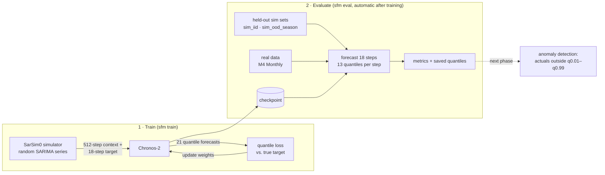

# SarSim0 forecasting models — D05 Anomaly team

Train time-series forecasting models on [SarSim0](https://github.com/kashif/sarsim0) synthetic data
("Zero-shot Forecasting by Simulation Alone", arXiv 2601.00970) and evaluate them zero-shot on
held-out simulated data and M4 Monthly. The saved quantile forecasts are the starting point for
forecast-residual anomaly detection.

The anomaly detector uses these forecasts to flag unusual readings, groups them into events,
and compares them with labelled anomalies in simulated data and UCR. Setup, commands and how
the scores work: [Anomaly detection](docs/anomaly-detection.md).

For remote GPU evaluation, `uv run sfm prepare-anomaly-handoff` packages the code, data and
chosen detector settings. Training runs remotely, and only if the results show it is needed.

Everything runs through one CLI, `sfm`, driven by YAML configs. The same config runs on a laptop
CPU, a consumer GPU, or DSMLP; only `--device` changes. Terms in *italics* are defined in the
[Glossary](docs/glossary.md).

## How it works

### The idea

We want a forecaster that works on data it has never been trained on, such as household
electricity, without collecting and labelling that data first. The SarSim0 paper's bet is that a
model trained **only on simulated series** can do this, as long as the simulator produces enough
*variety* (trends, seasonal cycles of many lengths, noise of many shapes) for the model to learn
general forecasting skills, not the quirks of one dataset. SarSim0 series are not meant to look
like any particular real data. They are meant to be diverse.

Once we have a forecaster that is good zero-shot, anomaly detection follows from its *quantile
forecasts*: the model gives a range of likely next values, and an actual reading far outside that
range (below q0.01 or above q0.99) gets flagged.

### The pipeline



1. **Environment** (`uv sync`, `sfm check`): install the pinned packages for CPU or GPU, then
   confirm SarSim0 and a few training steps work on this machine and how fast they run.
2. **Eval sets** (`sfm make-sim`, `sfm stage-m4`): write fixed test data to `data/eval/`. The
   model never trains on these. Two are simulated (one like training, one with seasonal periods
   training never produces) and two are real: M4 Quarterly for choosing between models and M4
   Monthly as the final test.
3. **Baselines** (`sfm eval --model seasonal_naive --model chronos2:amazon/chronos-2`): the bar
   to beat. Seasonal naive is the "dumb" forecast; pretrained Chronos-2 is Amazon's model before
   we touch it.
4. **Train** (`sfm train <config>`): stream SarSim0 data into Chronos-2 and update its weights
   (see [one training step](docs/architecture.md#one-training-step-concretely)). The config decides fine-tune vs. from scratch, steps, batch size,
   learning rate and device.
5. **Evaluate**: the final checkpoint forecasts every eval set. Per-series scores and the full
   quantile forecasts go to `outputs/<run>/eval/`.
6. **Compare** (`sfm results`): one markdown table of every run vs. the baselines, ready for the
   Experiments log.

What one training step does, the code layout and how to add a model: [docs/architecture.md](docs/architecture.md).

## Setup

Requires [uv](https://docs.astral.sh/uv/) (`curl -LsSf https://astral.sh/uv/install.sh | sh`, or
`pip install --user uv` on DSMLP). `uv.lock` pins every package, including SarSim0 at commit
`71306403`, so all machines get identical versions.

```bash
git clone git@github.com:DSC-Capstone-Azimuth-AI/chronos2-sarsim0-anomaly-team.git
cd chronos2-sarsim0-anomaly-team

uv sync --extra cpu      # laptop / no NVIDIA GPU (macOS uses the default PyPI torch)
uv sync --extra cu130    # NVIDIA GPU (driver supporting CUDA 13: local or DSMLP)

export HF_HOME="$PWD/.cache/huggingface"   # optional: keep model downloads in the repo
uv run sfm check                           # environment report, SarSim0 checks, timed train steps
```

`uv run sfm ...` uses the project environment without activating it; `source .venv/bin/activate`
then `sfm ...` also works.

## Running it

```bash
# 1. Eval sets (once per machine)
uv run sfm make-sim                        # data/eval/sim_iid + sim_ood_season (~10 s)

git clone --depth 1 --filter=blob:none --sparse \
  https://github.com/Mcompetitions/M4-methods.git external/M4-data
git -C external/M4-data sparse-checkout set Dataset
uv run sfm stage-m4                        # data/eval/m4_monthly (test) + m4_quarterly (validation)

# 2. Baselines
uv run sfm eval --model seasonal_naive --model chronos2:amazon/chronos-2

# 3. Train; the final checkpoint is evaluated on every set listed in `eval.datasets`
uv run sfm train configs/train/chronos2-ft-cpu.yaml
# Modify settings on the fly
uv run sfm train configs/train/chronos2-ft-5k.yaml --set train.max_steps=500 --set name=chronos2-ft-500

# PatchTST-FM r2: IBM's pretrained PatchTST, zero-shot / fine-tuned / scratch (docs/patchtst-fm.md)
uv run sfm eval --model patchtst_fm
uv run sfm train configs/train/patchtst-fm-ft-5k.yaml

# 4. Every result so far, as a markdown table (paste into the Experiments log)
uv run sfm results
```

Useful flags:

| Flag | Effect |
|---|---|
| `--device auto\|cpu\|cuda\|cuda:1\|mps` | override `runtime.device` (`auto` = CUDA if available, else CPU) |
| `--precision auto\|bf16\|fp32` | `auto` = bf16 on GPUs that support it, fp32 otherwise |
| `--set a.b=value` | override any config field; values are parsed as YAML (`--set eval.datasets=[sim_iid]`) |
| `--overwrite` | replace an existing run directory with the same `name` |
| `sfm check --config X --set data.batch_size=128` | measure s/step and peak VRAM before a long run |

Each run writes `outputs/<name>/`:

```text
run-config.json      resolved config + device, package versions, git SHA, dirty flag, SarSim0 commit,
                     and `timing` (train/eval/total seconds, finish time) once the run ends
train-log.csv        loss, grad norm, learning rate per logging step
checkpoint-final/    loadable with `--model <model.type>:<path>` (e.g. chronos2:<path>, patchtst_fm:<path>)
eval/<set>.parquet   per-series metrics + 13 quantiles (0.01 … 0.99) for every horizon step
eval/summary.json    aggregate metrics per eval set
```

## Experiment tracking (Weights & Biases)

Optional shared run table and live loss curves at
[wandb.ai/chewycrunch-ucsd/sarsim-fm](https://wandb.ai/chewycrunch-ucsd/sarsim-fm). Setup, commands,
sweeps and backfilling old runs: **[docs/wandb.md](docs/wandb.md)**.

```bash
uv sync --extra cu130 --extra wandb && uv run wandb login     # once per machine
uv run sfm train <config> --set wandb.enabled=true --set wandb.group=<question>
```

## Documentation

| Doc | What's in it |
|---|---|
| [docs/architecture.md](docs/architecture.md) | One training step, repo layout, what each module does, adding a model |
| [docs/patchtst-fm.md](docs/patchtst-fm.md) | PatchTST-FM r2: IBM's pretrained PatchTST, pretrained vs. scratch like Chronos-2 |
| [docs/evaluation.md](docs/evaluation.md) | Eval sets, metric definitions, known data issues |
| [docs/results.md](docs/results.md) | Experiments log: every run vs. baselines, with analysis |
| [docs/wandb.md](docs/wandb.md) | Weights & Biases: setup, commands, sweeps, backfill |
| [docs/naming.md](docs/naming.md) | How to name runs, configs and W&B groups |
| [docs/glossary.md](docs/glossary.md) | Time-series, SarSim0, model, training and evaluation terms |

**Current headline** ([details](docs/results.md)): a short fine-tune of Chronos-2 on SarSim0 only (`chronos2-ft-500`)
is the best model on M4 (MASE 0.904 vs. 0.922 pretrained); training 10× longer helps simulated
data but erases the M4 gain; the from-scratch run is still undertrained.
